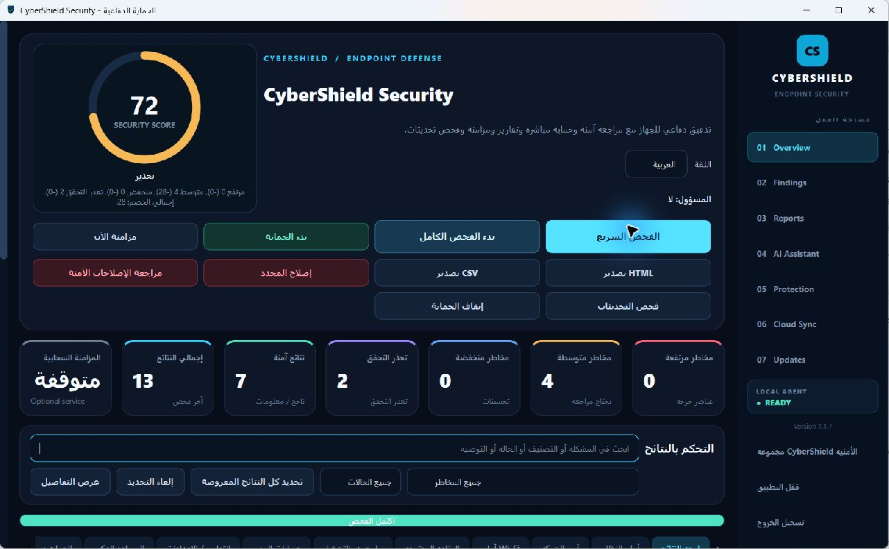
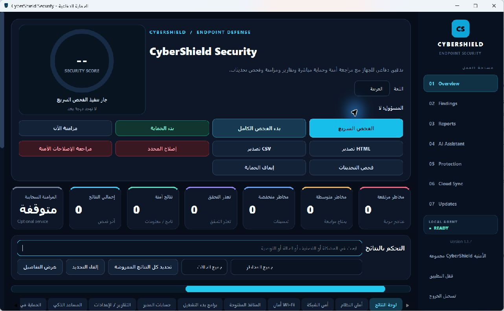
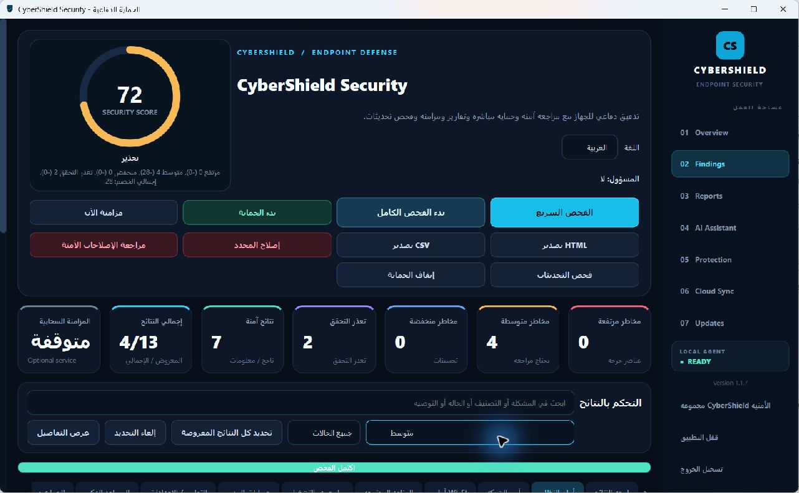
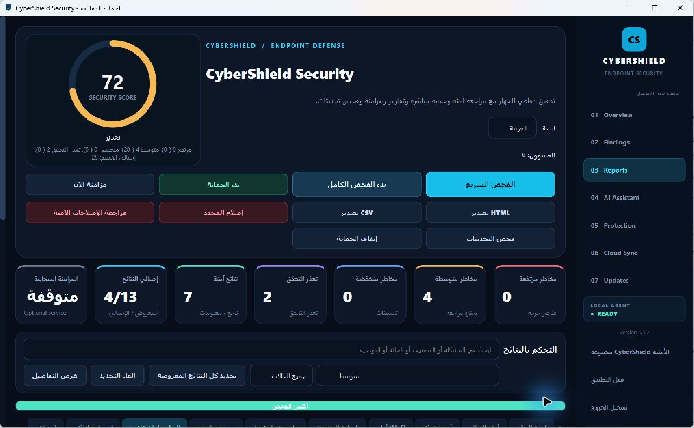
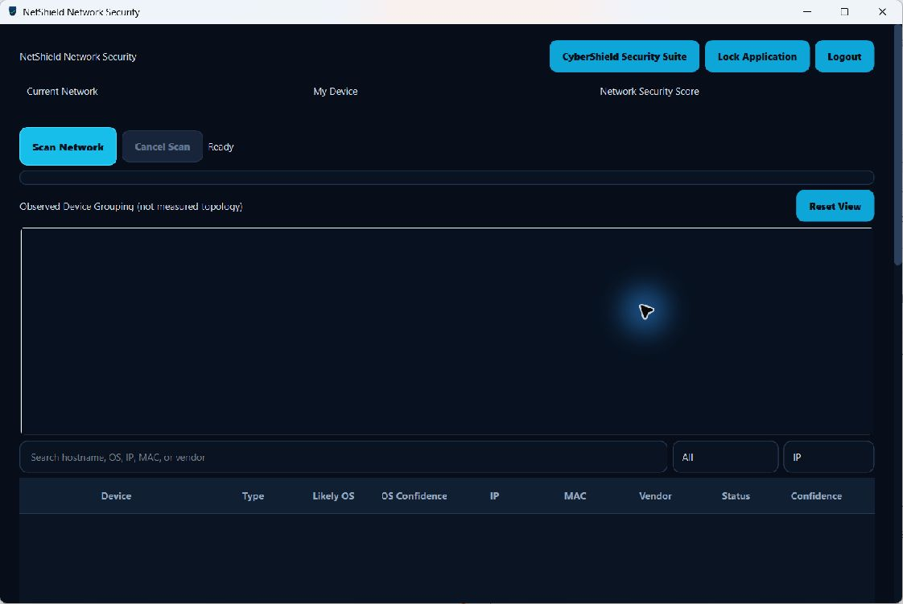
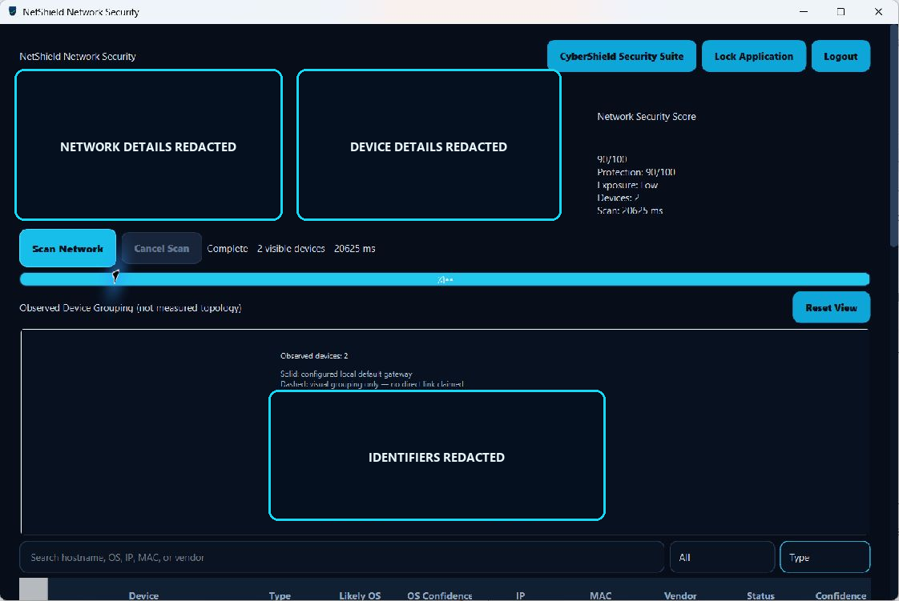
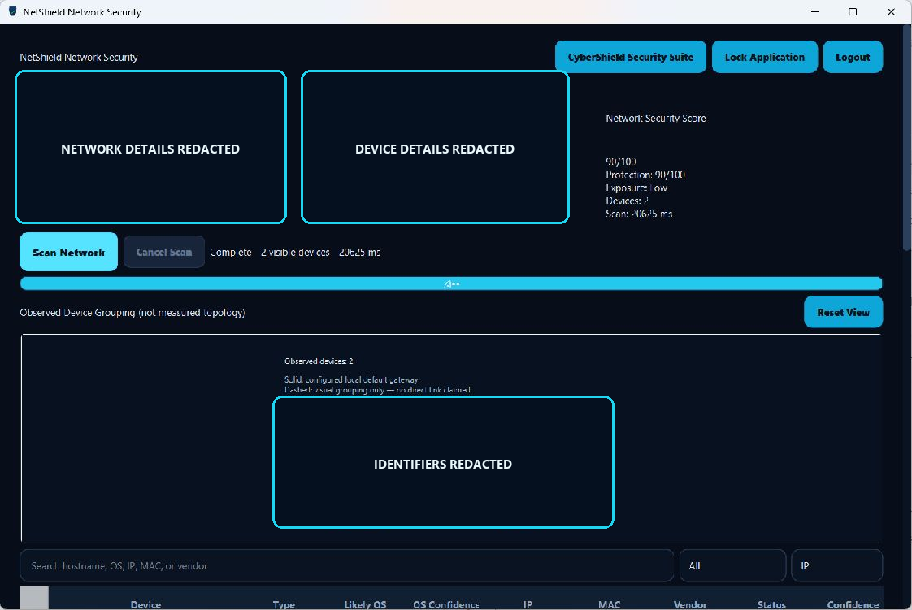
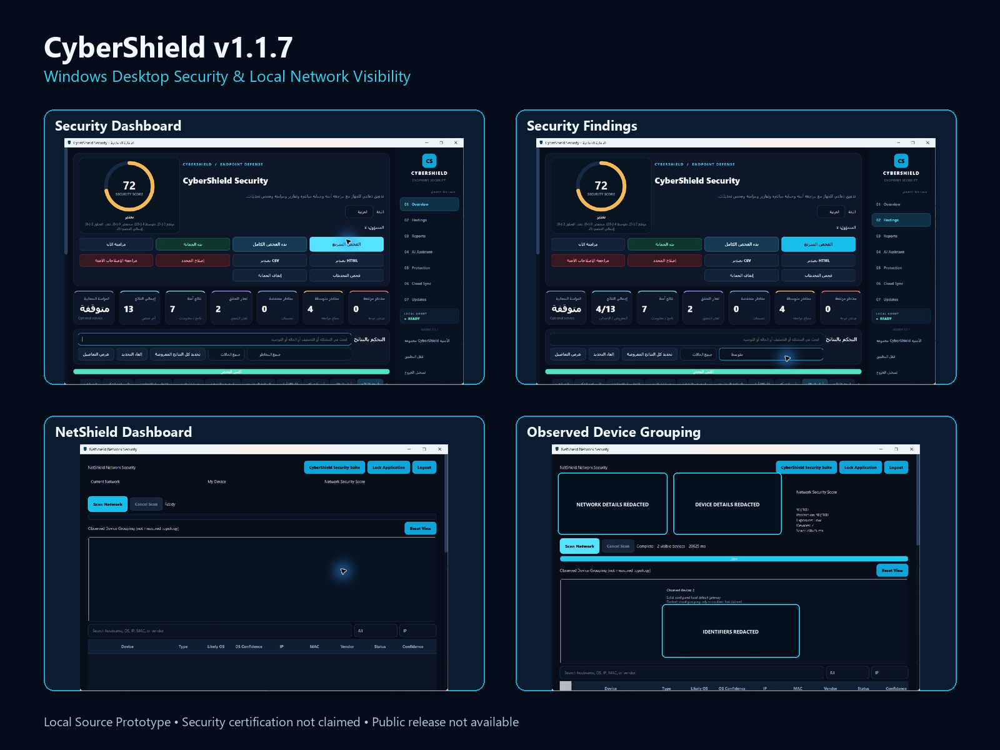

# 🛡️ CyberShield v1.1.7

### Windows Security & Local Network Visibility

**CyberShield** is a personal cybersecurity desktop application developed in Python for Windows. It combines local security assessment, security findings, reporting, and defensive network visibility through an integrated desktop interface.

**CyberShield** هو مشروع شخصي للأمن السيبراني، تم تطويره لنظام Windows باستخدام لغة Python. يهدف إلى تقييم إعدادات الأمان، وتحليل النتائج الأمنية، وإنشاء التقارير، واستكشاف الأجهزة الظاهرة على الشبكات المحلية المصرح بها.

---

## 🚀 Key Features | المميزات الرئيسية

### 🖥️ Windows Desktop Security
- Windows security configuration assessment.
- Quick Scan and Full Scan functionality.
- Security findings classification and analysis.
- Security scoring and risk overview.
- Local authentication and session management.
- Arabic and English desktop interface.

### 🌐 NetShield — Network Visibility
- Authorized local network device discovery.
- Device inventory and classification.
- IP, MAC, and available device information.
- Confidence-based device and operating-system identification.
- Observed Device Grouping visualization.
- Privacy-aware network reporting.

### 📊 Security Reports
- Security findings and risk summaries.
- CyberShield report export: **HTML and CSV**.
- NetShield report export: **HTML and JSON**.
- Local scan history and results review.
- Privacy protection for sensitive network identifiers.

---

## 🛠️ Technologies & Tools | التقنيات والأدوات المستخدمة

CyberShield was built using a combination of Python development tools, desktop UI frameworks, Windows system utilities, local database technologies, and automated testing frameworks.

### 💻 Core Technology Stack

| Technology | Purpose |
|---|---|
| **Python** | Main programming language for application logic, security scanners, network analysis, and reporting. |
| **PySide6 / Qt 6** | Native Windows desktop interface, dashboards, navigation, and bilingual UI support. |
| **SQLite** | Local storage for application data, scan history, and security findings. |
| **Argon2** | Secure password hashing for local authentication. |
| **PowerShell** | Windows security configuration and system information collection. |
| **ARP** | Local network device discovery using observed address information. |
| **Windows Neighbor Tables** | Discovering and reviewing devices visible to the local Windows system. |
| **HTML / CSS** | Security report presentation and formatting. |
| **CSV / JSON** | Structured security and network report exports. |

### 🔐 Security & Networking Technologies

**Windows Security Assessment**

CyberShield includes modules for reviewing Windows security settings, Wi-Fi configurations, local listening ports, and network exposure.

**NetShield Network Discovery**

NetShield uses a passive-first approach to identify devices observed on authorized private networks.

Its network visualization represents **Observed Device Grouping**, not verified physical network topology.

### 🧪 Testing & Development Tools

| Tool | Purpose |
|---|---|
| **pytest** | Automated unit, integration, and regression testing. |
| **QtTest** | Desktop interface behavior testing. |
| **FastAPI TestClient** | Testing optional API components. |
| **Git & GitHub** | Project documentation, portfolio presentation, and version management. |

### ⚙️ Additional Frameworks

The project also includes optional or development-stage components:

- **FastAPI / Uvicorn** — Optional API backend and development server.
- **Pydantic** — API request and response validation.
- **python-jose** — Authentication token handling for optional API components.
- **pywin32** — Windows-specific system integration and access-control operations.
- **PyInstaller** — Historical packaging configuration; public packaging remains deferred.

The primary application operates locally as a Windows desktop prototype. Production Cloud/API deployment is not part of the current accepted release.

---

## 🏗️ Project Architecture | بنية المشروع

CyberShield consists of two main functional components.

### 1. CyberShield Desktop Security

Responsible for:
- Windows security assessment.
- Scanner orchestration.
- Findings analysis and deduplication.
- Security score calculation.
- Local result storage.
- Security report generation.

### 2. NetShield

Responsible for:
- Local network context collection.
- Passive-first device discovery.
- Device inventory and classification.
- Observed-device visualization.
- Network assessment and reporting.

Both components are accessible through the desktop application.

---

## 🧪 Testing & Validation | الاختبارات والتحقق

The documented automated test baseline for **CyberShield v1.1.7** recorded:

| Test Metric | Result |
|---|---|
| Automated Tests Passed | **609** |
| Failed Tests | **0** |
| Process Exit Code | **0** |
| Final Local Acceptance | **Passed with Limitations** |

The final local acceptance covered selected workflows, including:

- Application startup from source.
- Local account creation and authentication.
- Desktop dashboard navigation.
- Quick Scan execution.
- Security findings and scoring display.
- HTML security report export.
- Authorized NetShield device discovery.

**Important:** Automated test success does not imply complete security validation, universal scanner accuracy, or production readiness.

---

## 📸 Screenshots | صور المشروع

The following screenshots demonstrate the desktop interface, security assessment workflow, reporting features, and NetShield network visibility.

### 01 — CyberShield Dashboard | الواجهة الرئيسية

### 02 — System Security Scan | فحص أمان النظام

### 03 — Security Findings | النتائج الأمنية

### 04 — Security Reports | التقارير الأمنية

### 05 — NetShield Dashboard | لوحة مراقبة الشبكة

### 06 — Network Device List | قائمة أجهزة الشبكة

### 07 — Observed Device Grouping | عرض الأجهزة المكتشفة

*This visualization represents observed device grouping and does not claim to measure physical network topology.*

### 08 — Features Overview | نظرة عامة على المميزات

**Privacy Notice:** Sensitive device names and network identifiers have been masked in the published screenshots.

---

## 📋 Project Information | معلومات المشروع

| Item | Details |
|---|---|
| Project Name | CyberShield |
| Version | 1.1.7 |
| Platform | Windows Desktop |
| Primary Language | Python |
| Desktop Framework | PySide6 / Qt 6 |
| Database | SQLite |
| Components | CyberShield Desktop Security + NetShield |
| Project Type | Personal Cybersecurity Project |
| Development Status | Local Source Prototype |
| Local Acceptance | Passed with Limitations |
| Source Code | Private |
| Public Installer | Not Available |
| Security Certification | Not Claimed |

---

## ⚠️ Development Status & Limitations | حالة التطوير والقيود

CyberShield v1.1.7 is a locally tested source prototype developed for personal cybersecurity learning, experimentation, and engineering practice.

The project has completed selected automated and local acceptance tests. However, several security and production-readiness areas remain unverified or deferred.

Known limitations include:

- Windows multi-account isolation has not been fully verified.
- Windows ACL enforcement remains unaccepted in real multi-account testing.
- Full Scan was not included in the final local manual acceptance.
- Production Cloud/API deployment is deferred.
- Public installer creation and code signing are not authorized.
- The application is not security-certified or production-ready.

**Project Status: Local Source Prototype — Accepted for limited personal use with documented limitations.**

---

## 🔒 Repository Purpose | الغرض من المستودع

This public repository is intended for:

- Project presentation.
- Technical documentation.
- Technology stack overview.
- Application screenshots.
- Demonstration of software engineering and cybersecurity skills.

**The application's source code is not included in this public repository.**

هذا المستودع مخصص للتعريف بالمشروع، وتوثيق التقنيات المستخدمة، وعرض صور التطبيق ومهارات التطوير والأمن السيبراني. الكود المصدري محفوظ بشكل خاص وغير منشور للعامة.

---

## 👨‍💻 Developer | المطور

**Omar Almotairi**

**Areas of Interest:** Cybersecurity, Windows Security, Networking, Python Development, IT Support, and Blue Team Security.

**GitHub:** https://github.com/omaralmotiriy

---

*CyberShield v1.1.7 — Personal Cybersecurity & Software Engineering Portfolio Project.*
